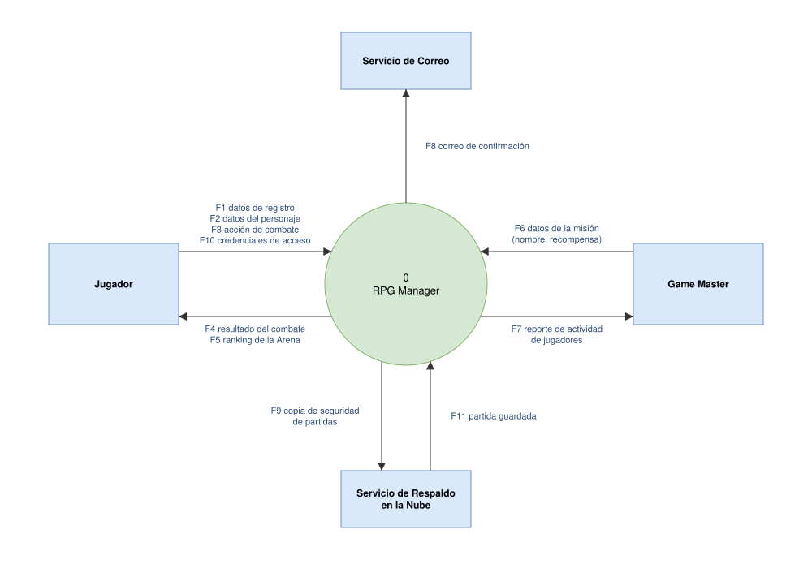
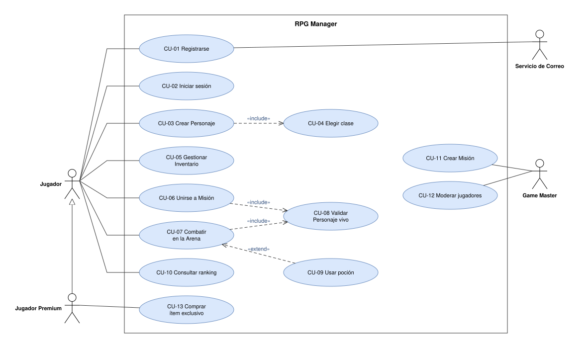
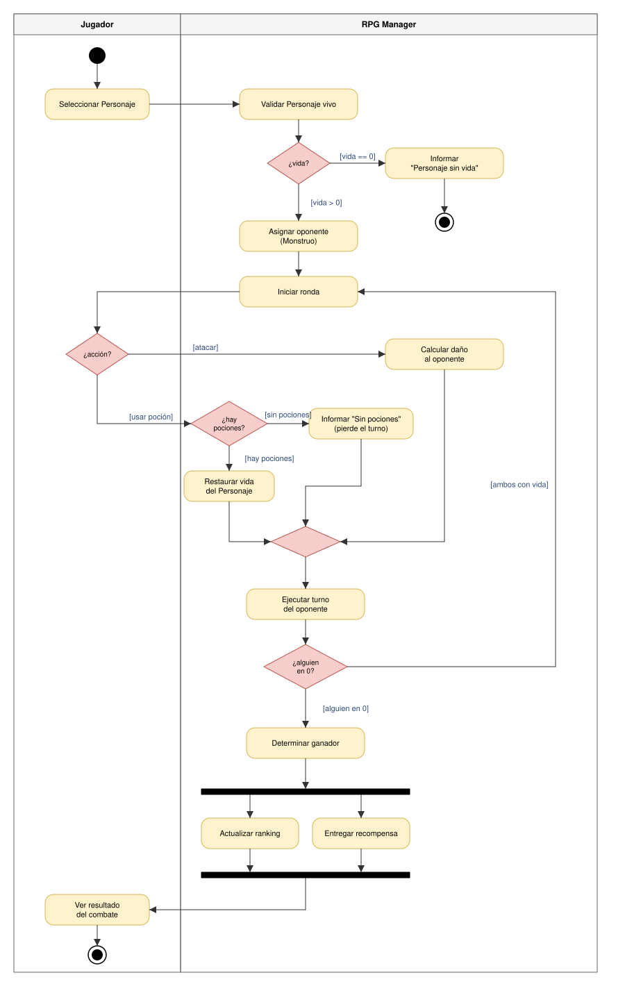
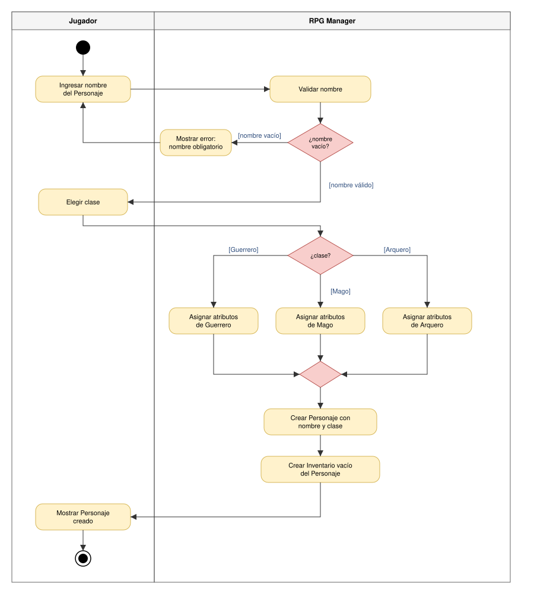

TALLER PRÁCTICO - ANÁLISIS DE SISTEMAS - DIAGRAMAS CON DRAW.IO (RPG MANAGER)

ARCHIVOS DE LA ENTREGA

- 01_contexto_rpg.drawio y 01_contexto_rpg.svg
- 02_casos_uso_rpg.drawio y 02_casos_uso_rpg.svg
- 03_actividades_combate.drawio (2 páginas: CU-07 y CU-03)
- 03_actividades_cu07.svg y 03_actividades_cu03.svg
- README.md (este archivo)

======================================================================
BLOQUE 1 - DIAGRAMA DE CONTEXTO
======================================================================

Flujos de datos (tabla 1.3 completa):

- F1 | Jugador | datos de registro | RPG Manager
- F2 | Jugador | datos del personaje (nombre, clase) | RPG Manager
- F3 | Jugador | acción de combate | RPG Manager
- F4 | RPG Manager | resultado del combate | Jugador
- F5 | RPG Manager | ranking de la Arena | Jugador
- F6 | Game Master | datos de la misión (nombre, recompensa) | RPG Manager
- F7 | RPG Manager | reporte de actividad de jugadores | Game Master
- F8 | RPG Manager | correo de confirmación | Servicio de Correo
- F9 | RPG Manager | copia de seguridad de partidas | Servicio de Respaldo en la Nube

EJERCICIO 1A - Flujos que faltan

- F10 | Jugador | credenciales de acceso (usuario y contraseña) | RPG Manager
- F11 | Servicio de Respaldo en la Nube | partida guardada | RPG Manager

F10 se nombra con el dato que viaja, no con la acción "iniciar sesión". F11 va en sentido contrario a F9: el respaldo devuelve al sistema la partida que antes recibió.

BUG A CORREGIR - Diagrama de contexto

- Error 1: La "Base de datos de Personajes" no es una entidad externa. Es un almacén de datos que está dentro del sistema, y en el nivel 0 no se dibujan almacenes de datos (aparecen desde el DFD de nivel 1).
- Error 2: "Crear Personaje" es una acción (un caso de uso), no un dato. El flujo debe nombrarse con un sustantivo, por ejemplo "datos del personaje".
- Error 3: Una flecha directa de Jugador a Game Master conecta dos entidades externas entre sí. Todo flujo debe pasar por el sistema, y además "mensaje" no dice qué dato viaja.

CHECKLIST: un solo proceso numerado 0 (cumple), 4 entidades externas (cumple), todas las flechas con nombre de datos (cumple), ninguna flecha entre entidades externas (cumple), sin bases de datos (cumple).

======================================================================
BLOQUE 2 - DIAGRAMA DE CASOS DE USO
======================================================================

Relaciones: CU-03 «include» CU-04, CU-06 «include» CU-08, CU-07 «include» CU-08, CU-09 «extend» CU-07. Los actores están fuera del límite del sistema, las asociaciones no tienen punta y las flechas punteadas van en la dirección correcta (include: del caso base al incluido; extend: del opcional al base).

EJERCICIO 2A - Generalización de actores

El diagrama ya incluye al Jugador Premium (generalización hacia Jugador) y el caso CU-13 Comprar ítem exclusivo asociado solo a él.

- ¿Hacia dónde apunta el triángulo vacío y por qué? Hacia el Jugador, que es el actor general (el "padre"). El Jugador Premium es una especialización: es un tipo especial de Jugador y hereda lo que este puede hacer.
- ¿Por qué el Jugador Premium NO necesita líneas a CU-01 ... CU-10? Porque la generalización ya le hace heredar todas las asociaciones del Jugador. Solo se dibuja la línea de lo propio: CU-13.

BUG A CORREGIR - Casos de uso

- Error 1: Un caso de uso llamado "Inventario" es solo un sustantivo. Debe ser verbo + sustantivo y expresar un objetivo del actor: "Gestionar Inventario".
- Error 2: El actor Game Master está dibujado dentro del rectángulo. Los actores van siempre fuera del límite del sistema.
- Error 3: La flecha «include» va en dirección invertida. Debe salir del caso base (CU-03 Crear Personaje) hacia el incluido (CU-04 Elegir clase).
- Error 4: Una asociación directa entre los actores Jugador y Game Master no existe en este diagrama. Los actores solo se relacionan con casos de uso, no entre sí.

======================================================================
BLOQUE 3 - DIAGRAMAS DE ACTIVIDADES
======================================================================

CU-07 Combatir en la Arena (incluye la decisión de pociones del ejercicio 3A):

EJERCICIO 3A - ¿Y si se acaban las pociones?

- ¿En qué carril va la decisión? En el carril RPG Manager, porque es el sistema quien conoce el inventario del personaje y verifica si quedan pociones.
- Guarda 1: [hay pociones] -> va a la acción "Restaurar vida del Personaje".
- Guarda 2: [sin pociones] -> va a la acción 'Informar "Sin pociones"' (el turno se pierde y continúa con "Ejecutar turno del oponente").

EJERCICIO 3B - Actividades de CU-03 Crear Personaje

Incluye carriles Jugador y RPG Manager, la decisión de nombre vacío (si lo está, muestra un error y el Jugador vuelve a ingresar el nombre), la decisión de tres salidas [Guerrero], [Mago], [Arquero] y la acción que crea el Inventario vacío del Personaje.

- ¿Qué caso de uso del Bloque 2 aparece "escondido" dentro de este flujo? CU-04 Elegir clase (el «include» de Crear Personaje).

BUG A CORREGIR - Diagrama de actividades

- Error 1: Un rombo con una sola salida [sí]. Toda decisión necesita guardas en todas sus salidas y deben cubrir todos los casos; falta la salida [no].
- Error 2: Un fork cuyos dos caminos terminan cada uno en su propio nodo final, sin join. El fork debe cerrarse con un join que espere a que ambos caminos terminen, y recién ahí continuar hacia un único nodo final.
- Error 3: "Calcular daño al oponente" está en el carril del Jugador. Lo ejecuta el sistema, así que debe estar en el carril RPG Manager. Un carril equivocado hace que el diagrama mienta sobre la responsabilidad.

======================================================================
BLOQUE 5 - PREGUNTAS DE REFLEXIÓN
======================================================================

1. ¿Por qué el diagrama de contexto no muestra la base de datos del RPG Manager si el sistema sí la usa?
Porque en el nivel 0 el sistema es una caja negra: solo interesa qué datos entran y salen con el exterior. La base de datos es parte interna del sistema (un almacén de datos), no una entidad externa, y se muestra desde el DFD de nivel 1 en adelante.

2. ¿Cuál es la diferencia entre el flujo de datos "datos del personaje" y el caso de uso "Crear Personaje"?
"datos del personaje" es información que viaja entre el Jugador y el sistema (un sustantivo, qué se envía). "Crear Personaje" es un objetivo que el actor logra con el sistema (verbo + sustantivo, qué se hace). El primero va en el diagrama de contexto y el segundo en el de casos de uso.

3. Da un ejemplo propio del RPG Manager de «include» y otro de «extend» que no estén en este taller.
- «include»: CU-11 Crear Misión «include» Validar permisos de Game Master (siempre se verifica que quien crea la misión tenga ese rol).
- «extend»: CU-07 Combatir en la Arena <- «extend» Huir del combate (solo ocurre si el jugador decide escapar).

4. ¿Qué información aporta el diagrama de actividades que el de casos de uso no puede mostrar?
El orden de los pasos, las decisiones con sus condiciones, los ciclos (rondas), el paralelismo (fork/join) y quién ejecuta cada paso (carriles). El de casos de uso solo dice qué puede hacer cada actor.

5. El paso "Calcular daño al oponente" será un método en POO. ¿En qué clase crees que vive y por qué?
En la clase Personaje (por ejemplo un método atacar(oponente)), porque el daño depende de los atributos del atacante (clase, fuerza, nivel). La clase Arena de Combate solo orquesta las rondas y llama a ese método.

6. ¿Cuándo preferirías PlantUML y cuándo draw.io en un proyecto real?
PlantUML cuando la documentación técnica cambia seguido y se versiona en Git, porque los cambios se leen línea a línea. draw.io cuando necesito controlar el diseño visual para presentar o explicar, o un diagrama con mucho detalle visual.

======================================================================
EVIDENCIA
======================================================================

URL de mi commit: (pegar aquí la URL github.com/.../commit/...)
# TallerDraw.io
